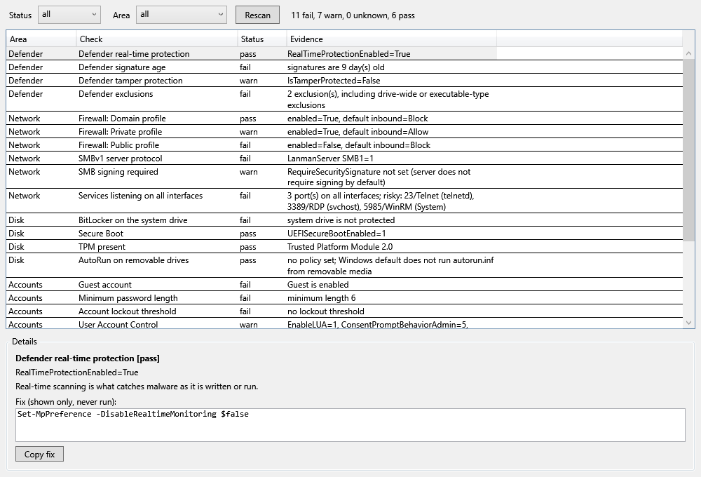

# winharden

A read-only security posture check for Windows. It looks at about two dozen settings (Defender, firewall, BitLocker, SMB, RDP, UAC, Secure Boot, TPM, updates, local account policy, AutoRun, PowerShell logging, listening ports) and tells you which are fine, which are worth a look, and which are not. For every non-passing check it prints the evidence, one sentence on why it matters, and the command that would fix it. The fix is only printed. Nothing is ever run, and nothing is changed.

It runs fine without admin. Checks that need elevation come back as `unknown (needs admin)` instead of guessing.

The screenshot is the GUI fed with made-up results for an invented, badly configured machine.

## Run it

Windows PowerShell 5.1, no dependencies.

    powershell -ExecutionPolicy Bypass -File winharden.ps1
    powershell -ExecutionPolicy Bypass -File winharden.ps1 -Json > report.json
    powershell -ExecutionPolicy Bypass -File winharden.ps1 -Html report.html
    powershell -ExecutionPolicy Bypass -File winharden.ps1 -Area Network,Disk

The module can also be used directly: `Import-Module .\WinHarden.psm1; Invoke-WinHardenAudit`. Each result has `Id, Area, Title, Status, Evidence, Why, Fix, NeedsAdmin`; status is `pass`, `warn`, `fail` or `unknown`.

## The window

    powershell -ExecutionPolicy Bypass -File winharden-gui.ps1

A plain WPF window: a grid of all checks (area, check, status, evidence), filters for status and area, and a details pane for the selected row with the reason and the fix text. Copy fix puts the fix on the clipboard; Rescan runs the audit again. The script re-launches itself under `-STA` if needed.

`-SelfTest` builds the window with injected fake results, checks the row counts and filters, and exits without showing anything; add `-Png` to render `docs\screenshot.png` through RenderTargetBitmap.

## Tests

    powershell -ExecutionPolicy Bypass -File tests\run-tests.ps1

Every system read goes through a table of reader scriptblocks (`New-WinHardenReader`), and the tests swap in fake ones, so they touch neither the registry nor the real machine. They cover the pass/warn/fail/unknown branches of each check, unreadable values, non-English `net accounts` output, an all-throwing reader, HTML escaping, and a JSON round trip, plus the GUI self-test. They were run on Windows PowerShell 5.1.

## Demo result set

The screenshot's invented machine gives 24 checks: 6 pass, 7 warn, 11 fail, 0 unknown.

- Failing: signatures 9 days old, drive-wide Defender exclusions, public firewall profile off, SMBv1 on, telnet, RDP and WinRM listening on all interfaces, BitLocker off, guest account enabled, minimum password length 6, no lockout threshold, NLA off while RDP is on, last update install 140 days ago.
- Warnings: tamper protection off, private firewall profile allows inbound, SMB signing not required, UAC not on the secure desktop, Remote Desktop enabled, execution policy Unrestricted, script block logging off.
- Passing: real-time protection, domain firewall profile, Secure Boot, TPM, AutoRun, automatic updates.

These come from the fake reader in `tests\FakeReaders.ps1`, not from a real machine.

## Known gaps

- Several readings are the unelevated route, which is less exact than the admin one. BitLocker uses the Explorer shell property, Secure Boot reads the registry state key instead of `Confirm-SecureBootUEFI`, and TPM only checks that a device exists.
- `net accounts` is parsed by English labels; other languages give `unknown`.
- The listening-port check flags a short list of well-known risky ports. A listener on 0.0.0.0 can still be blocked by the firewall, and this does not evaluate firewall rules.
- Group Policy and MDM-managed settings are only seen where they land in the registry.
- Thresholds (signature age, password length 12, update age 35 days) are my own picks, not a benchmark.
- The GUI scans before it opens, so it takes a few seconds to appear.
